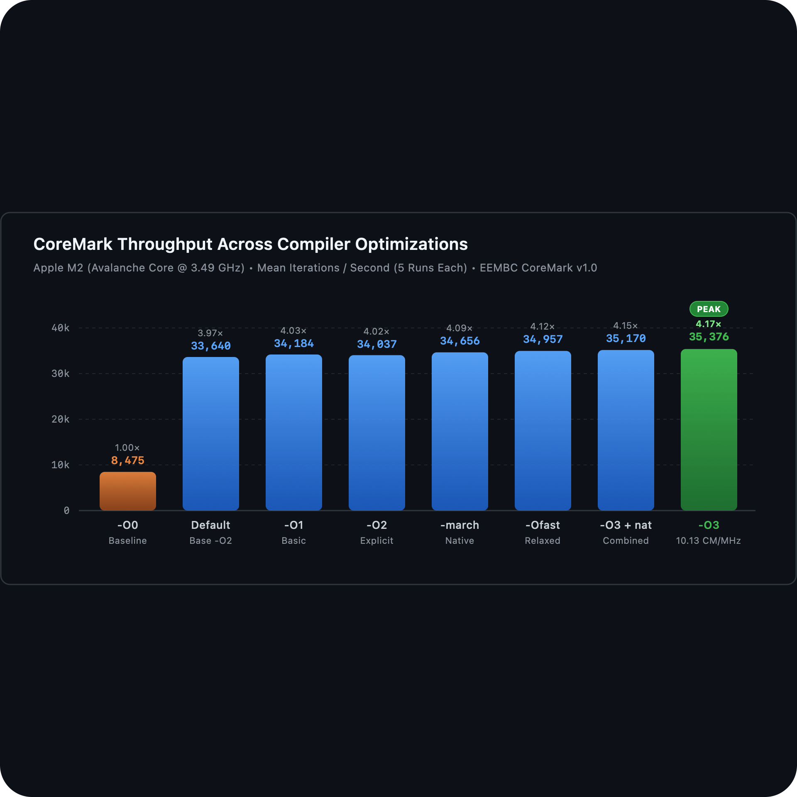

# CoreMark: Workload Profiling & Compiler Optimization Analysis

[](LICENSE)
[](https://www.eembc.org/coremark/)
[](#system-architecture--hardware-topology)
[](#overview)

A rigorous architectural benchmarking study and automated evaluation harness assessing compiler optimization levels (`-O0` to `-Ofast`, `-march=native`), instruction-level parallelism, and RISC-V ISA extensions using the industry-standard **EEMBC CoreMark v1.0** suite. Built as part of the **CMPE 344 (Computer Organization)** curriculum at **Boğaziçi University**.

---

## Table of Contents
- [Overview](#overview)
- [Key Objectives](#key-objectives)
- [System Architecture & Hardware Topology](#system-architecture--hardware-topology)
- [Benchmark Configurations & Methodology](#benchmark-configurations--methodology)
- [Empirical Performance Results](#empirical-performance-results)
  - [Throughput Comparison Table](#throughput-comparison-table)
  - [Graphical Performance Scaling](#graphical-performance-scaling)
- [Optimization Breakdown & Microarchitectural Insights](#optimization-breakdown--microarchitectural-insights)
- [CoreMark Workload Algorithms](#coremark-workload-algorithms)
- [Target RISC-V ISA Extensions Analysis](#target-risc-v-isa-extensions-analysis)
- [Project Structure](#project-structure)
- [Prerequisites & Usage](#prerequisites--usage)
- [Full Technical Report](#full-technical-report)
- [License](#license)
- [Related Projects](#related-projects)

---

## Overview

Selecting the optimal processor core and compiler configuration in embedded and general-purpose system design requires balancing computational throughput, dynamic power dissipation, and silicon footprint. Unlike legacy synthetic benchmarks (e.g., Dhrystone) that suffer from compiler over-optimization and standard library dependencies (`printf`, `malloc`), **CoreMark** isolates genuine integer CPU pipeline performance through carefully bounded, deterministic algorithms.

This repository provides an automated benchmarking harness across 8 compiler configurations, empirical performance data with statistical rigor, and an in-depth architectural evaluation establishing baseline metrics for subsequent evaluation on the configurable **CORE-V Wally RISC-V processor**.

---

## Key Objectives

1. **Compiler Optimization Evaluation**: Measure raw CoreMark throughput (`Iterations/Sec`) across optimization flags (`-O0`, `-O1`, `-O2`, `-O3`, `-Ofast`, `-march=native`).
2. **Microarchitectural Profiling**: Compute normalized **CoreMark/MHz** metrics to isolate true IPC (Instructions Per Cycle) and pipeline efficiency independent of clock frequency.
3. **Algorithmic Dissection**: Provide technical analysis of CoreMark's 4 core integer kernels (linked list processing, matrix arithmetic, state machine handling, and CRC verification).
4. **RISC-V Architectural Extension Mapping**: Detail instruction formats, hardware trade-offs, and area/performance impacts for **RV32I**, **RV32IM**, **RV32IMC**, **RV32GC**, and **RV64I**.

---

## System Architecture & Hardware Topology

All host benchmark runs were conducted bare-metal on physical hardware without hypervisor or virtualization distortion:

| Component | Hardware Specification |
| :--- | :--- |
| **System Model** | Apple MacBook Air (Model: `Mac14,2`, Apple Silicon) |
| **Processor** | Apple M2 (ARMv8.5-A 64-bit, 8-wide decode out-of-order execution) |
| **Core Topology** | 8 Cores (4× Performance *Avalanche* @ 3.49 GHz, 4× Efficiency *Blizzard* @ 2.42 GHz) |
| **L1 Cache** | 128 KiB L1-Instruction, 64 KiB L1-Data per P-core |
| **L2 Cache** | 16 MiB shared L2 (P-cluster), 4 MiB shared L2 (E-cluster) |
| **System Memory** | 16 GB unified LPDDR5 SDRAM (~100 GB/s bandwidth) |
| **Compiler / OS** | Apple Clang/LLVM 21.0.0 (`arm64`), macOS Darwin 25.6.0 |

---

## Benchmark Configurations & Methodology

The automated test harness ([`scripts/run_benchmarks.py`](scripts/run_benchmarks.py)) systematically evaluates 8 configurations:
- Each configuration executes **5 independent runs** satisfying the EEMBC > 10-second rule.
- Calibration iterations (400,000 to 600,000) are dynamically measured and validated with CRC self-checking (`seedcrc: 0xe9f5`).
- Statistics (mean throughput, standard deviation, min/max) are extracted and saved to structured JSON.

---

## Empirical Performance Results

### Throughput Comparison Table

*Benchmark execution conducted on Apple M2 (Avalanche P-Core nominal peak: 3492 MHz):*

| Compiler Configuration | Flag / Parameter | Mean Throughput (iter/s) | Std. Dev. ($\sigma$) | Speedup vs -O0 | CoreMark/MHz |
| :--- | :--- | :---: | :---: | :---: | :---: |
| **`-O0`** | `-O0` (Unoptimized Baseline) | **8,474.61** | 17.97 | $1.00\times$ | 2.43 |
| **`-O1`** | `-O1` (Basic Optimization) | **34,183.66** | 379.98 | $4.03\times$ | 9.79 |
| **Default** | *Base* (`-O2` in `PORT_CFLAGS`) | **33,640.41** | 1,295.91 | $3.97\times$ | 9.63 |
| **`-O2`** | `XCFLAGS="-O2"` (Explicit) | **34,037.43** | 469.46 | $4.02\times$ | 9.75 |
| **`-march=native`** | `XCFLAGS="-march=native"` | **34,655.81** | 157.83 | $4.09\times$ | 9.92 |
| **`-Ofast`** | `XCFLAGS="-Ofast"` | **34,957.08** | 310.58 | $4.12\times$ | 10.01 |
| **`-O3 -march=native`** | `XCFLAGS="-O3 -march=native"` | **35,169.57** | 595.23 | $4.15\times$ | 10.07 |
| **`-O3`** | `XCFLAGS="-O3"` (Peak Throughput) | **35,376.00** | 517.44 | **$4.17\times$** | **10.13** |

### Graphical Performance Scaling

<p align="center">
  
</p>

| Configuration | Compiler Flags | Iterations / Sec | Normalized Output | Speedup vs -O0 |
| :--- | :--- | :---: | :--- | :---: |
| **`-O0`** | `-O0` *(Baseline)* | 8,474.61 | `████▌` (24.0%) | 1.00× |
| **Default** | *Base* (`-O2` in `PORT_CFLAGS`) | 33,640.41 | `██████████████████` (95.1%) | 3.97× |
| **`-O2`** | `XCFLAGS="-O2"` | 34,037.43 | `██████████████████▎` (96.2%) | 4.02× |
| **`-O1`** | `XCFLAGS="-O1"` | 34,183.66 | `██████████████████▍` (96.6%) | 4.03× |
| **`-march=native`** | `XCFLAGS="-march=native"` | 34,655.81 | `██████████████████▋` (98.0%) | 4.09× |
| **`-Ofast`** | `XCFLAGS="-Ofast"` | 34,957.08 | `██████████████████▊` (98.8%) | 4.12× |
| **`-O3 -march=native`** | `XCFLAGS="-O3 -march=native"` | 35,169.57 | `██████████████████▉` (99.4%) | 4.15× |
| **`-O3`** | `XCFLAGS="-O3"` *(Peak Throughput)* | **35,376.00** | `████████████████████` (100.0%) | **4.17×** |

---

## Optimization Breakdown & Microarchitectural Insights

1. **The Memory-Bound Penalty of `-O0`**: Disables register allocation; intermediate variables spill continuously to stack frames via `LDR`/`STR`. Execution stalls on store-to-load forwarding queues and memory pipeline latency, yielding only 2.43 CoreMark/MHz.
2. **The $4.03\times$ Quantum Leap at `-O1`**: Static Single Assignment (SSA) form, Common Subexpression Elimination (CSE), and graph-coloring register allocation retain matrix accumulators and list pointers within ARM general-purpose registers (`X0`–`X30`), eliminating memory bus traffic.
3. **The `-O1` vs `-O2` Plateau**: Because CoreMark's kernels are compact (e.g. pointer chasing in linked lists cannot be vectorized), standard `-O2` inlining offers marginal improvement over `-O1`.
4. **Peak Instruction-Level Parallelism at `-O3`**: Loop unrolling and software pipelining in `core_matrix.c` amortize branch overhead, feeding the Apple M2's 8-wide out-of-order execution engine to reach **10.13 CoreMark/MHz** (compared to 2.5–3.5 for standard embedded RISC-V cores).
5. **Architectural Tuning via `-march=native`**: Yields the tightest standard deviation ($\sigma = 157.83$), proving that microarchitecture-aligned instruction scheduling minimizes Branch Target Buffer (BTB) mispredictions.

---

## CoreMark Workload Algorithms

The benchmark consists of four self-contained, realistic workloads:

```
CoreMark Execution Suite
├── Linked List Traversal & Sorting (core_list_join.c)
│   └── Stresses pointer-chasing, data cache latency, and non-contiguous memory access.
├── Matrix Arithmetic & Decomposition (core_matrix.c)
│   └── Evaluates integer multiply-accumulate (MAC), loop overhead, and register reuse.
├── Moore / Mealy Finite State Machine (core_state.c)
│   └── Measures data-dependent branch prediction and state transition efficiency.
└── 16-bit Cyclic Redundancy Check (core_util.c)
    └── Validates run correctness (CRC verification) and evaluates bitwise shift/XOR operations.
```

---

## Target RISC-V ISA Extensions Analysis

| Extension | Key Instructions | Hardware / Silicon Trade-Off | Primary Architectural Impact |
| :--- | :--- | :--- | :--- |
| **RV32I** | 47 Base Integer Instructions | Minimal silicon gate count (~15k gates); no hardware multiplier | Software-emulated multiplication/division via multi-cycle shifts/adds. |
| **RV32IM** | `MUL`, `MULH`, `DIV`, `REM` | Adds dedicated hardware array multiplier and radix-2/4 divider | Dramatically reduces instruction count in matrix arithmetic (`core_matrix.c`). |
| **RV32IMC** | 16-bit Compressed Instructions | +400 gates for 16-to-32-bit instruction expander in fetch stage | **25%–30% code size reduction**, drastically improving instruction cache hit rates. |
| **RV32GC** | `IMAFD` + `Zicsr` + `Zifencei` | Substantial silicon area (~100k+ gates), FPU pipeline | Full POSIX / Linux capability; handles double-precision floating-point. |
| **RV64I** | 64-bit XLEN, 64-bit registers | Double datapath width, increased dynamic switching power | Direct access to large physical address spaces (>4 GB) without banking. |

---

## Project Structure

```
CoreMark-Workload-Profiling/
├── Makefile                       # Top-level orchestration (benchmark, report, clean)
├── LICENSE                        # MIT License
├── README.md                      # Comprehensive documentation and results
├── results/
│   └── benchmark_results.json     # Complete empirical test data across 8 configurations
├── scripts/
│   └── run_benchmarks.py          # Portable, automated Python benchmark runner
├── report/
│   ├── report.pdf                 # Publication-quality compiled technical report
│   ├── report.tex                 # Full LaTeX source with TikZ/PGFPlots diagrams
│   └── prelab2_FF78_G17.pdf       # Archived course submission artifact
└── coremark/                      # EEMBC CoreMark v1.0 benchmark engine
    ├── core_list_join.c           # Linked list manipulation workload
    ├── core_main.c                # Harness initialization and timing calibration
    ├── core_matrix.c              # Matrix multiplication workload
    ├── core_state.c               # State machine validation workload
    ├── core_util.c                # CRC verification and utility functions
    ├── coremark.h                 # Algorithm definitions and configuration headers
    ├── Makefile                   # CoreMark make engine
    └── docs/                      # Profiling visualizations and documentation
```

---

## Prerequisites & Usage

### 1. Prerequisites

- **Python 3.8+**
- **Clang / GCC** (with C99 support)
- **Make**
- **LaTeX** (*Optional*, for compiling `report/report.tex` via `pdflatex`)

### 2. Run the Benchmark Suite

Run all 8 configurations (5 runs each) automatically:

```bash
make benchmark
```

Or execute directly via Python:

```bash
python3 scripts/run_benchmarks.py
```

Results are printed to standard output and exported to `results/benchmark_results.json`.

### 3. Compile the LaTeX Report

```bash
make build-report
```

---

## Full Technical Report

The complete, publication-formatted 6-page technical report with comprehensive TikZ diagrams, memory access charts, and detailed mathematical models is available at [report/report.pdf](report/report.pdf).

---

## License

This project is licensed under the **MIT License**. CoreMark source code is subject to EEMBC licensing terms. See the [LICENSE](LICENSE) file for details.

---

## Related Projects

- **[Solar-Escape-RISCV-Navigator](https://github.com/yigitsarpavci/Solar-Escape-RISCV-Navigator)**: Bare-metal RISC-V assembly simulation for fuel-constrained westward autonomous navigation.
- **[SchedSim-CPU-Scheduler](https://github.com/yigitsarpavci/SchedSim-CPU-Scheduler)**: Low-level CPU scheduling simulator written in x86-64 GNU Assembly.
- **[Aura-Functional-Interpreter](https://github.com/yigitsarpavci/Aura-Functional-Interpreter)**: Custom functional programming language interpreter with static/dynamic scoping.
- **[Nightpass-A-Survival-Card-Game](https://github.com/yigitsarpavci/Nightpass-A-Survival-Card-Game)**: Turn-based survival card game engine focusing on algorithmic fairness.

---

*Developed by Yiğit Sarp Avcı*
